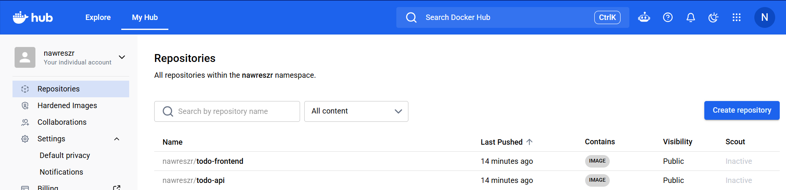
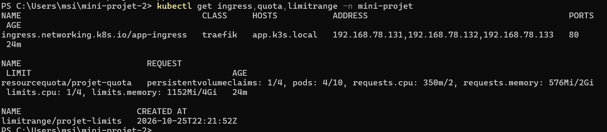
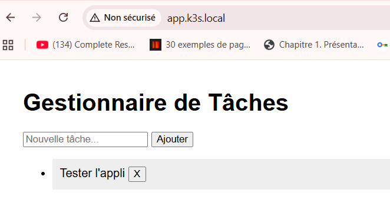
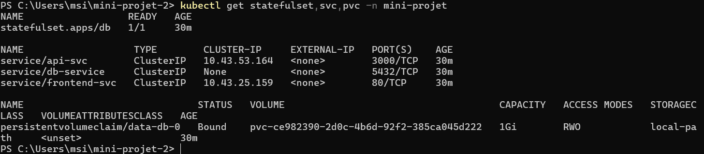
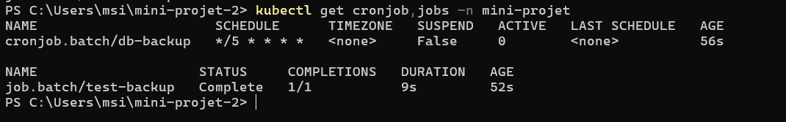
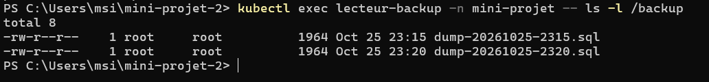
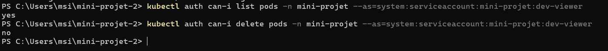
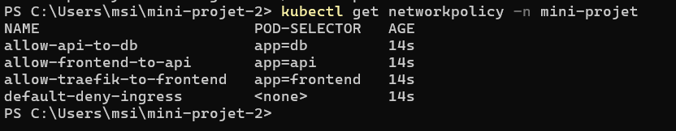
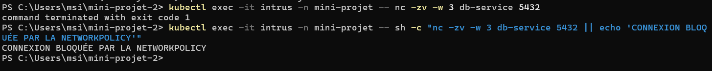
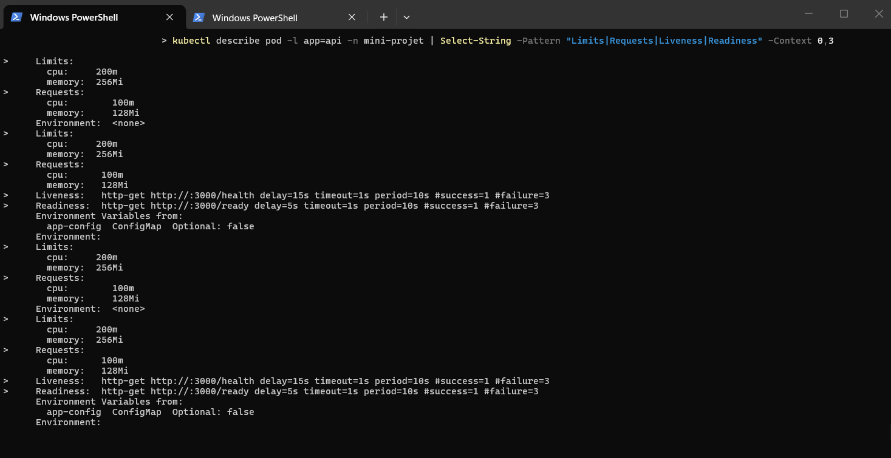

# Mini-projet 2 – Application trois niveaux sur k3s : sécurisée et persistante

> **Auteur :** Nawres Zarrouki
> **Cours :** Orchestration de conteneurs avec Kubernetes (k3s) – fin de la Partie 2 (configuration, données et sécurité)

Une application composée d'un **frontend**, d'une **API REST** et d'une **base de données** est déployée sur le cluster k3s du cours, puis rendue exploitable : configuration externalisée, secrets protégés, données persistantes et sauvegardées, ressources maîtrisées, surface d'attaque réduite (RBAC, durcissement des Pods, NetworkPolicies).

> L'évaluation porte sur l'**exploitation sur Kubernetes**, pas sur la qualité du code de l'application.

## Sommaire

1. [Application et architecture](#1-application-et-architecture)
2. [Prérequis et ordre de déploiement](#2-prérequis-et-ordre-de-déploiement)
3. [Exigences E1 à E15 et preuves](#3-exigences-e1-à-e15-et-preuves)
4. [Démarche par phases](#4-démarche-par-phases)
5. [Procédure de sauvegarde et de restauration](#5-procédure-de-sauvegarde-et-de-restauration)
6. [Matrice des flux réseau](#6-matrice-des-flux-réseau)
7. [Justification des exceptions de durcissement](#7-justification-des-exceptions-de-durcissement)

---

## 1. Application et architecture

| Rubrique | Valeur |
|---|---|
| Application | _À compléter : nom et fonctionnalités (CRUD sur une entité)_ |
| Frontend | _À compléter : framework_, servi par `nginxinc/nginx-unprivileged` (port 8080) |
| API | _À compléter : langage / framework_, routes `/health` et `/ready` |
| Base de données | _À compléter : PostgreSQL, MySQL, MariaDB ou MongoDB_ |

Toute la configuration passe par des variables d'environnement (`DB_HOST`, `DB_PORT`, `DB_NAME`, `DB_USER`, `DB_PASSWORD`, `API_PORT`) ; aucun secret n'est dans le code ni dans les images.

```
                      Utilisateur
                          |
                  Ingress (Traefik)
                    app.k3s.local
                          |
                  Service frontend-svc
                          |
              Deployment frontend (nginx)
                  /api/ -> api-svc
                          |
                   Service api-svc
                          |
                Deployment api (2 réplicas)
                          |
                    Service db (headless)
                          |
             StatefulSet db  <--- PVC data (1 Gi)
                          ^
                          |
        CronJob db-backup ---> PVC backup

   Namespace : ResourceQuota + LimitRange + RBAC + NetworkPolicies
```

Seul le **frontend** est exposé par l'Ingress. L'API n'est pas accessible de l'extérieur : le frontend relaie les appels `/api/` de l'intérieur du cluster. La base n'est joignable que par l'API et par le job de sauvegarde.

---

## 2. Prérequis et ordre de déploiement

**Prérequis :** cluster k3s (3 VM), `kubectl` configuré, images accessibles à tous les nœuds (registre public ou import manuel avec `k3s ctr images import`), entrée `app.k3s.local` dans le fichier `hosts` du poste :

```
<IP-D-UN-NOEUD>  app.k3s.local
```

**Ordre de déploiement :**

```bash
# 1. Namespace, quota et limites
kubectl apply -f k8s/00-namespace

# 2. Secret : copier le modèle, remplacer les valeurs, NE PAS le versionner
cp k8s/10-config/secret.example.yaml secret.yaml     # puis éditer secret.yaml
kubectl apply -f secret.yaml

# 3. Configuration, base de données, applications, sécurité
kubectl apply -f k8s/10-config
kubectl apply -f k8s/20-db
kubectl apply -f k8s/30-app
kubectl apply -f k8s/40-security

kubectl -n mini-projet get all,pvc,ingress,networkpolicy
```

Le vrai `secret.yaml` est dans le `.gitignore` : seul `secret.example.yaml` (fausses valeurs) est versionné.

---

## 3. Exigences E1 à E15 et preuves

| N° | Thème | Exigence | Preuve |
|---|---|---|---|
| E1 | Images | 3 images versionnées (pas de `latest`), accessibles à tous les nœuds | Phase 1 |
| E2 | Namespace | Namespace dédié, `ResourceQuota` et `LimitRange` | Phase 2 |
| E3 | Configuration | `ConfigMap` (non sensible) et `Secret` (identifiants) | Phase 3 |
| E4 | Secrets | Aucun secret réel dans Git (fichier modèle) | Phase 3 |
| E5 | Base de données | `StatefulSet`, `volumeClaimTemplates`, Service headless | Phase 4 |
| E6 | Persistance | Les données survivent à la suppression du Pod de la base | Phase 7 |
| E7 | Démarrage | L'API attend la base (init container / probe `/ready`) | Phase 5 |
| E8 | Ressources | `requests` et `limits` sur chaque conteneur | Phases 4 et 5 |
| E9 | Sondes | Readiness `/ready`, liveness `/health` | Phase 5 |
| E10 | Exposition | Seul le frontend est exposé par l'Ingress `app.k3s.local` | Phase 6 |
| E11 | Sauvegarde | `CronJob` sur volume dédié, restauration testée | Phase 8 |
| E12 | RBAC | `ServiceAccount` dédiés sans jeton monté, compte de consultation limité | Phase 9 |
| E13 | Durcissement | Non-root, `allowPrivilegeEscalation: false`, capabilities retirées | Phase 10 |
| E14 | Réseau | `NetworkPolicies` conformes à la matrice de flux | Phase 10 |
| E15 | Dépôt | Manifestes par dossier et `README.md` de déploiement | Ce dépôt |

---

## 4. Démarche par phases

### Phase 0 : développement et test en local

Application testée en local (Docker Compose ou base dans un conteneur) : création, lecture, modification et suppression d'une donnée depuis l'interface.

### Phase 1 : conteneurisation et publication (E1)

Un Dockerfile par composant, utilisateur non-root, images **versionnées** (`:1.0.0`).

Fichier `app/api/Dockerfile` :

```dockerfile
FROM node:20-alpine
WORKDIR /app
COPY package*.json ./
RUN npm install
COPY . .
USER node
EXPOSE 3000
CMD ["node", "index.js"]
```

Fichier `app/frontend/Dockerfile` :

```dockerfile
FROM nginxinc/nginx-unprivileged:1.25-alpine
COPY index.html /usr/share/nginx/html/
COPY default.conf /etc/nginx/conf.d/default.conf
EXPOSE 8080
```

```bash
docker build -t <compte>/<application>-api:1.0.0 ./app/api
docker build -t <compte>/<application>-frontend:1.0.0 ./app/frontend
docker build -t <compte>/<application>-db:1.0.0 ./app/db   # si image de base personnalisée
docker push <compte>/<application>-api:1.0.0
```

### Phase 2 : namespace, quotas et limites (E2)

_(aucun manifeste trouvé dans `k8s/00-namespace`)_

### Phase 3 : ConfigMap et Secret (E3, E4)

`app-config` contient les paramètres non sensibles, `db-credentials` les identifiants. Le vrai Secret n'est jamais versionné : le dépôt contient `secret.example.yaml` avec de fausses valeurs.

_(aucun manifeste trouvé dans `k8s/10-config`)_

### Phase 4 : base de données en StatefulSet (E5)

Service headless `db`, `StatefulSet` avec `volumeClaimTemplates` (1 Gi, `local-path`), `PGDATA` dans un sous-dossier du point de montage et readiness probe `pg_isready`.

_(aucun manifeste trouvé dans `k8s/20-db`)_

### Phase 5 : API et frontend (E7, E8, E9)

API en 2 réplicas, configuration injectée par `envFrom` et `secretKeyRef`, init container qui attend la base, readiness `/ready`, liveness `/health`. Le frontend relaie `/api/` vers `api-svc` via un `ConfigMap` nginx monté en fichier.

_(aucun manifeste trouvé dans `k8s/30-app`)_

### Phase 6 : Ingress (E10)

Seul le frontend est exposé sur `app.k3s.local`.

### Phase 7 : persistance et résilience (E6)

Des données sont saisies, puis le Pod `db-0` est supprimé. Une fois recréé par le StatefulSet, il reprend le même volume : aucune donnée n'est perdue.

```bash
kubectl -n mini-projet delete pod db-0
kubectl -n mini-projet get pods -w
```

### Phase 8 : sauvegarde planifiée et restauration (E11)

Un `CronJob` exécute `pg_dump` vers `backup-pvc` (toutes les 5 minutes pour la démonstration). Le test immédiat se fait avec :

```bash
kubectl -n mini-projet create job --from=cronjob/db-backup test-backup
kubectl -n mini-projet logs job/test-backup
```

La procédure complète de restauration est décrite à la [section 5](#5-procédure-de-sauvegarde-et-de-restauration).

### Phase 9 : RBAC (E12)

Un `ServiceAccount` par composant (`api-sa`, `frontend-sa`, `db-sa`) avec `automountServiceAccountToken: false`, et un compte `dev-viewer` limité à `get`, `list`, `watch` sur les Pods, leurs logs et les Services.

```bash
kubectl auth can-i list pods   --as=system:serviceaccount:mini-projet:dev-viewer -n mini-projet   # yes
kubectl auth can-i delete pods --as=system:serviceaccount:mini-projet:dev-viewer -n mini-projet   # no
kubectl auth can-i get secrets --as=system:serviceaccount:mini-projet:dev-viewer -n mini-projet   # no
```

### Phase 10 : durcissement et NetworkPolicies (E13, E14)

Pods applicatifs : `runAsNonRoot: true`, `allowPrivilegeEscalation: false`, `capabilities.drop: ["ALL"]`, `readOnlyRootFilesystem: true` quand c'est possible (avec `emptyDir` sur `/tmp` et le cache nginx). Le namespace applique `pod-security.kubernetes.io/enforce=baseline`.

Manifestes de sécurité (RBAC, durcissement, NetworkPolicies) :

_(aucun manifeste trouvé dans `k8s/40-security`)_

Tests des NetworkPolicies : depuis un Pod de test **sans** label `tier: api`, la connexion à la base échoue ; depuis le Pod de l'API, elle réussit ; l'application reste utilisable depuis le navigateur.

---

## 5. Procédure de sauvegarde et de restauration

**Sauvegarde automatique :** le `CronJob` `db-backup` écrit un fichier `dump-AAAAMMJJ-HHMM.sql` sur `backup-pvc`.

**Restauration (procédure type, à adapter à vos noms) :** un Pod temporaire monte le volume de sauvegarde. Il porte le label `tier: backup`, indispensable pour être autorisé vers la base par les NetworkPolicies.

```bash
kubectl -n mini-projet apply -f - <<'YAML'
apiVersion: v1
kind: Pod
metadata:
  name: db-restore
  labels:
    tier: backup
spec:
  restartPolicy: Never
  containers:
    - name: restore
      image: postgres:16-alpine
      command: ["sleep", "3600"]
      env:
        - name: PGHOST
          value: db
        - name: PGUSER
          valueFrom: { secretKeyRef: { name: db-credentials, key: POSTGRES_USER } }
        - name: PGPASSWORD
          valueFrom: { secretKeyRef: { name: db-credentials, key: POSTGRES_PASSWORD } }
        - name: PGDATABASE
          valueFrom: { configMapKeyRef: { name: app-config, key: DB_NAME } }
      volumeMounts:
        - { name: backup, mountPath: /backup }
  volumes:
    - name: backup
      persistentVolumeClaim:
        claimName: backup-pvc
YAML

kubectl -n mini-projet exec db-restore -- ls /backup
kubectl -n mini-projet exec db-restore -- psql -f /backup/<FICHIER>.sql
kubectl -n mini-projet delete pod db-restore
```

Vérifier ensuite dans l'application que la donnée supprimée est revenue.

---

## 6. Matrice des flux réseau

| Source | Destination | Autorisé |
|---|---|---|
| Traefik (namespace `kube-system`) | frontend | Oui |
| frontend | api | Oui |
| api | db (port 5432) | Oui |
| job de sauvegarde | db (port 5432) | Oui |
| frontend | db | Non |
| tout autre Pod | api, db | Non |

Démarche : politique `default-deny-ingress` sur le namespace, puis une politique par flux autorisé.

---

## 7. Justification des exceptions de durcissement

> _À adapter à vos manifestes : listez ici chaque exception et sa raison._

| Composant | Exception | Justification |
|---|---|---|
| Base de données | `readOnlyRootFilesystem` non appliqué | La base écrit sur son volume de données et l'image impose son propre utilisateur |
| Frontend | `emptyDir` sur `/tmp` et le cache nginx | nginx a besoin d'un répertoire inscriptible pour son cache |

---

## Captures supplémentaires

**Capture 01 Images DockerHub**



**Capture 02 Namespace Quota**



**Capture 03 Application Fonctionnelle**



**Capture 04 StatefulSet PVC**



**Capture 05 Persistance Donnees.png **


**Capture 06 CronJob Sauvegarde**



**Capture 07 Fichiers SQL**



**Capture 08 RBAC Securite**



**Capture 09 NetworkPolicies**



**Capture 10 Test Blocage Reseau**



**Capture 11 Sondes Ressources**



